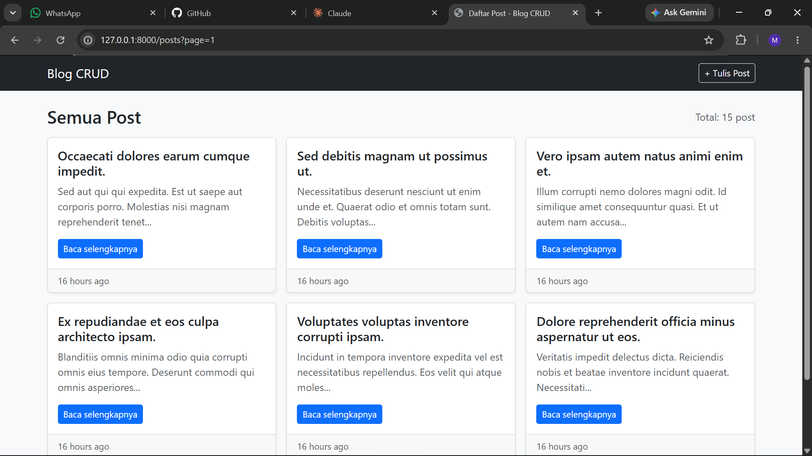
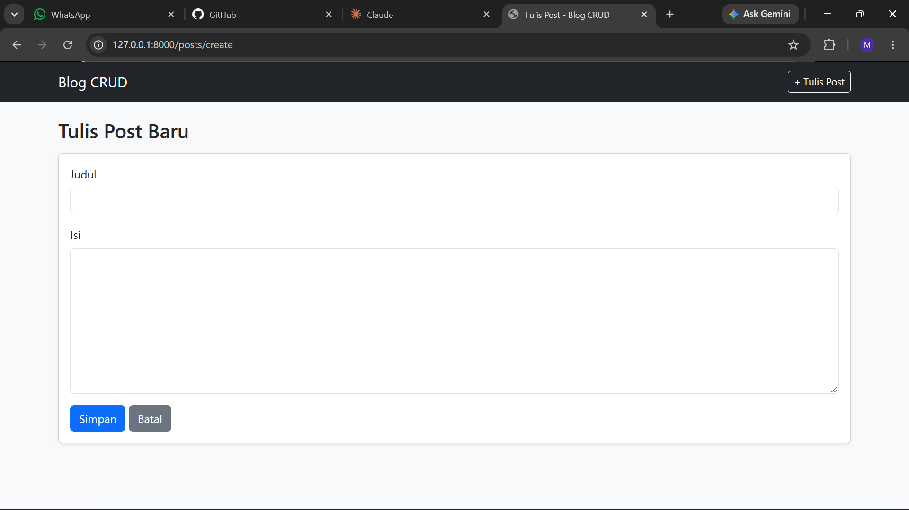
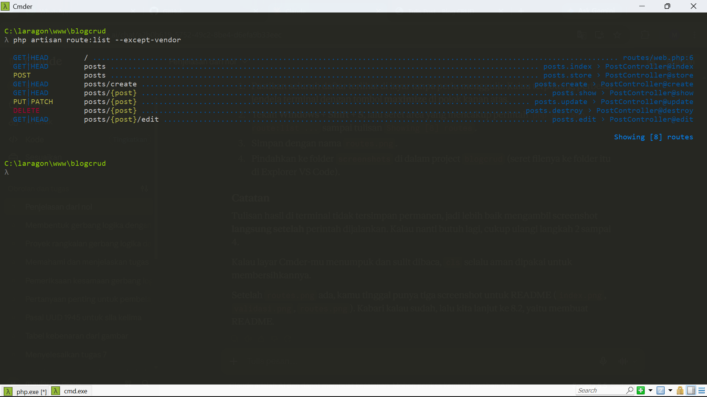

# Tugas Rutin 10 - Blog CRUD Laravel

**Nama:** Maulana Akbar Said Hasugian
**NIM:** 4252550012
**Mata Kuliah:** Pemrograman Web

## Deskripsi

Aplikasi blog sederhana dengan fitur CRUD (lihat, tambah, ubah, hapus post) menggunakan Laravel.

## Fitur yang Dikerjakan

- `Route::resource('posts')` dengan named routes
- `PostController` resource (7 method)
- Layout master dengan `@extends` dan `@yield`
- Dua Blade component: `alert` dan `card`
- Validasi form, pesan error per field, dan old input
- Flash message sukses dan gagal
- `@csrf` di semua form, `@method('PUT')` dan `@method('DELETE')`
- Route Model Binding dan pagination (6 post per halaman)

## Cara Menjalankan

1. Salin repository ini, lalu masuk ke foldernya.
2. Jalankan `composer install`.
3. Salin `.env.example` menjadi `.env`, lalu atur koneksi database (`DB_DATABASE=blogcrud_db`).
4. Buat database `blogcrud_db` di MySQL.
5. Jalankan `php artisan key:generate`.
6. Jalankan `php artisan migrate`.
7. Isi data contoh lewat `php artisan tinker`, lalu ketik `App\Models\Post::factory(15)->create();`
8. Jalankan `php artisan serve`, lalu buka `http://127.0.0.1:8000`.

## Daftar Route

| Method    | URL                    | Nama          | Fungsi           |
| --------- | ---------------------- | ------------- | ---------------- |
| GET       | `/posts`             | posts.index   | Daftar post      |
| GET       | `/posts/create`      | posts.create  | Form tambah      |
| POST      | `/posts`             | posts.store   | Simpan post baru |
| GET       | `/posts/{post}`      | posts.show    | Detail post      |
| GET       | `/posts/{post}/edit` | posts.edit    | Form edit        |
| PUT/PATCH | `/posts/{post}`      | posts.update  | Simpan perubahan |
| DELETE    | `/posts/{post}`      | posts.destroy | Hapus post       |

## Screenshot

Halaman daftar post:

Validasi form:

Daftar route:

# Tugas Rutin 10 - Blog CRUD Laravel

**Nama:** Maulana Akbar Said Hasugian

**NIM:** 4252550012

**Mata Kuliah:** Pemrograman Web

## Deskripsi

Aplikasi blog sederhana dengan fitur CRUD (lihat, tambah, ubah, hapus post) menggunakan Laravel.

## Fitur yang Dikerjakan

- `Route::resource('posts')` dengan named routes

- `PostController` resource (7 method)

- Layout master dengan `@extends` dan `@yield`

- Dua Blade component: `alert` dan `card`

- Validasi form, pesan error per field, dan old input

- Flash message sukses dan gagal

- `@csrf` di semua form, `@method('PUT')` dan `@method('DELETE')`

- Route Model Binding dan pagination (6 post per halaman)

## Cara Menjalankan

1. Salin repository ini, lalu masuk ke foldernya.

2. Jalankan `composer install`.

3. Salin `.env.example` menjadi `.env`, lalu atur koneksi database (`DB_DATABASE=blogcrud_db`).

4. Buat database `blogcrud_db` di MySQL.

5. Jalankan `php artisan key:generate`.

6. Jalankan `php artisan migrate`.

7. Isi data contoh lewat `php artisan tinker`, lalu ketik `App\Models\Post::factory(15)->create();`

8. Jalankan `php artisan serve`, lalu buka `http://127.0.0.1:8000`.

## Daftar Route

| Method | URL | Nama | Fungsi |

|---|---|---|---|

| GET | `/posts` | posts.index | Daftar post |

| GET | `/posts/create` | posts.create | Form tambah |

| POST | `/posts` | posts.store | Simpan post baru |

| GET | `/posts/{post}` | posts.show | Detail post |

| GET | `/posts/{post}/edit` | posts.edit | Form edit |

| PUT/PATCH | `/posts/{post}` | posts.update | Simpan perubahan |

| DELETE | `/posts/{post}` | posts.destroy | Hapus post |

## Screenshot

Halaman daftar post:

Validasi form:

Daftar route:

# Tugas Rutin 10 - Blog CRUD Laravel

**Nama:** Maulana Akbar Said Hasugian

**NIM:** 4252550012

**Mata Kuliah:** Pemrograman Web

## Deskripsi

Aplikasi blog sederhana dengan fitur CRUD (lihat, tambah, ubah, hapus post) menggunakan Laravel.

## Fitur yang Dikerjakan

- `Route::resource('posts')` dengan named routes

- `PostController` resource (7 method)

- Layout master dengan `@extends` dan `@yield`

- Dua Blade component: `alert` dan `card`

- Validasi form, pesan error per field, dan old input

- Flash message sukses dan gagal

- `@csrf` di semua form, `@method('PUT')` dan `@method('DELETE')`

- Route Model Binding dan pagination (6 post per halaman)

## Cara Menjalankan

1. Salin repository ini, lalu masuk ke foldernya.

2. Jalankan `composer install`.

3. Salin `.env.example` menjadi `.env`, lalu atur koneksi database (`DB_DATABASE=blogcrud_db`).

4. Buat database `blogcrud_db` di MySQL.

5. Jalankan `php artisan key:generate`.

6. Jalankan `php artisan migrate`.

7. Isi data contoh lewat `php artisan tinker`, lalu ketik `App\Models\Post::factory(15)->create();`

8. Jalankan `php artisan serve`, lalu buka `http://127.0.0.1:8000`.

## Daftar Route

| Method | URL | Nama | Fungsi |

|---|---|---|---|

| GET | `/posts` | posts.index | Daftar post |

| GET | `/posts/create` | posts.create | Form tambah |

| POST | `/posts` | posts.store | Simpan post baru |

| GET | `/posts/{post}` | posts.show | Detail post |

| GET | `/posts/{post}/edit` | posts.edit | Form edit |

| PUT/PATCH | `/posts/{post}` | posts.update | Simpan perubahan |

| DELETE | `/posts/{post}` | posts.destroy | Hapus post |

## Screenshot

Halaman daftar post:

Validasi form:

Daftar route:

